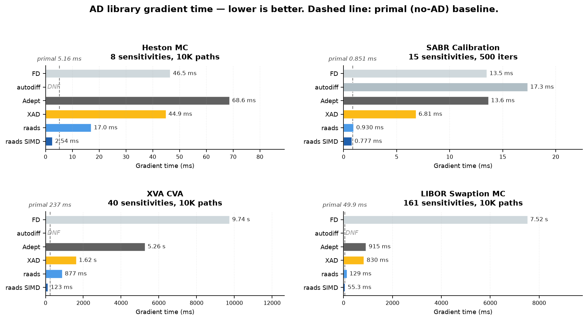

# raads

Compile-time adjoint algorithmic differentiation in Rust. You write a branch-free function once, generic over `AdNum`; a macro turns it into SIMD code, straight-line apart from the function's own loops, for the value, the gradient in one reverse pass, and Hessian-vector products (forward-over-reverse).

- `raads`: the core (`#[kernel]`, `AdNum`, `Real`, `Dual`, SIMD `Lanes`).
- `raads-engines`: Monte Carlo path (`paths`) and 1-D PDE (`pde1d`) engines that run a few kernels in their loops and return gradients w.r.t. every model parameter.
- `raads-finance`: option models (Black-Scholes, SVI, American exercise) and option surfaces on the engines.

## Any function

`#[kernel]` keeps the function and adds a module with compiled forward and reverse code. Parameters without `#[data]` get gradients.

```rust
use raads::prelude::*;

/// f(x, y; z) = exp(x y) + sqrt(x^2 + z) / y
#[kernel]
pub fn f<N: AdNum>(v: [N; 2], #[data] z: N) -> N {
    let (x, y) = (v[0], v[1]);
    (x * y).exp() + (x * x + z).sqrt() / y
}

let value = f([0.5, 2.0], 1.0); // plain call

let mut grad = [0.0; 2]; // value and [df/dx, df/dy] in one reverse pass
let value = f::vjp(&[0.5, 2.0], 1.0, 1.0, &mut grad);

let mut h = [Dual::from(0.0); 2]; // second order: Hessian column for x
f::vjp(&[Dual::new(0.5, 1.0), Dual::from(2.0)], Dual::from(1.0), Dual::from(1.0), &mut h);
println!("{value} {grad:?} d2f/dx2 {} d2f/dydx {}", h[0].t, h[1].t);
```

`DualVec<_, K>` carries `K` tangents, so `DualVec::unit(x_i, i)` on every input gives the whole Hessian in one pass.

## An engine: a PDE and its gradient

`#[kernels(engine)]` compiles the kernels an engine asks for. Here `pde1d` solves `u_τ = k u_xx` from `u(x, 0) = exp(-x²)` and reads `u(x0, T)` with its gradient w.r.t. `k`, `x0` and `T`.

```rust
use raads::prelude::*;
use raads_engines::pde1d::{self, Grid};

pub struct Heat; // params: k, x0, T

#[kernels(raads_engines::pde1d)]
impl Heat {
    // u_τ = a u_xx + b u_x - c u
    pub fn coeffs<N: AdNum>(#[data] _x: N, p: [N; 3]) -> [N; 3] {
        [p[0], N::from(0.0), N::from(0.0)]
    }
    pub fn initial<N: AdNum>(#[data] x: N, _p: [N; 3]) -> N {
        (-(x * x)).exp()
    }
    pub fn x0<N: AdNum>(p: [N; 3]) -> N {
        p[1]
    }
    pub fn horizon<N: AdNum>(p: [N; 3]) -> N {
        p[2]
    }
}

let r = pde1d::gradient::<Heat, f64>(&[1.0, 0.5, 0.25], &Grid::new(-6.0, 6.0, 401, 400));
println!("u {} du/dk {} du/dx0 {} du/dT {}", r.value, r.grad[0], r.grad[1], r.grad[2]);
```

For option prices and Greeks, see `raads-finance` (`crates/raads-finance`, with a quickstart example).

## Performance



Heston MC, SABR calibration, XVA and LIBOR swaption from [XAD's benchmark suite](https://github.com/auto-differentiation/ad-benchmarks), with raads added: gradient time, f64, Apple M5, single core. Details, more benchmarks (Enzyme, second order) and how to reproduce: [`benchmarks/`](benchmarks).

raads needs nightly Rust (`std::simd`); `rust-toolchain.toml` pins the version. On x86_64, build with `RUSTFLAGS="-C target-cpu=x86-64-v3"` (AVX2 + FMA) or `native`; default builds get SSE2 without FMA, which is much slower.

## License

MIT or Apache-2.0, at your option.
